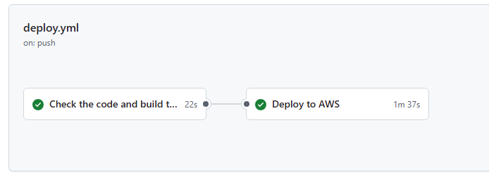

# Build journal

A running log of how I built Birthday Buddy: what I did, what went wrong, how I fixed it, why I picked each service, what it costs, and what is next. Newest information is added at the bottom of each section as the project grows.

Status at a glance:

| Piece | Status |
|---|---|
| Web app and API logic (runs locally) | Done |
| DynamoDB table with two indexes, deployed with CDK | Done |
| Lambda functions and API Gateway | Next |
| S3 and CloudFront website hosting | Planned |
| Hourly reminder job (EventBridge) and SES email | Planned |
| Cognito login | Planned |

---

## 1. The idea and the first version (4 Oct 2026)

**Goal.** I want to move into cloud engineering, so I wanted a project I could build properly on AWS and construct it according to industry standards. The brief: a static website plus an email reminder alert. I settled on a birthday reminder app: save the birthdays you care about, and get an email before each one, every year.

**What I built.** A plain HTML, CSS and JavaScript website and a Node.js backend. The business logic lives in one file, `service.js`, which knows nothing about HTTP or AWS. It receives a `storage` and a `mailer`, so locally they are an in-memory store and a console printout, and in the cloud they become DynamoDB and SES. Because of that, moving to AWS means writing new entry points, not rewriting the app.

**What went wrong, and how I fixed it**

| Problem | What I did |
| I first added a login (email and password with signed tokens), then decided the project should start simpler | Removed it and kept "enter your email" for now. Login is planned properly with Cognito |
| For gift ideas I first used a free recipe API (TheMealDB), but its cakes are recipes to bake, not things to buy | Dropped the outside API for a hand-picked list of gift ideas, each with a Google Maps and a web search link |
| I looked for a free Grab API for delivery | Grab's APIs are for restaurants (GrabFood) and approved business partners (GrabExpress), not individual developers, so I linked to search results instead as its more easier and flexible with whatever the recipient likes, and is not limited to what API services offer or the availability of API.|

**Why a curated list and not an API.** No keys, no outside dependency, no cost, more flexibility and nothing to break. A real shop API can be added later as another file next to it.

---

## 2. Choosing the database: DynamoDB, not RDS

I compared them for this app's needs.

| | DynamoDB | RDS (PostgreSQL) |
|---|---|---|
| Cost model | Pay per request, idle is near zero(serverless) | Pay per hour for a running server |
| Rough cost for a few rows | Pennies a month | About a few tens of dollars ($10+)  |
| Fits this app because | One flat list of independent birthdays, with lookups I know in advance | Better when data has many linked tables |
| Setup | Create a table | A private network (VPC), security groups, a password, connection handling |

**Decision: DynamoDB.** With no login, the data is one simple list, and I know my three lookups (one item by id, everything for an email, everything due on a given day). For login I plan to use Cognito, which keeps the accounts, so my database only stores birthdays.

**Cost note.** Via the use of amazon free tier, DynamoDB has an always-free allowance of 25 GB of storage. My indexes each keep a copy of the data, so I store roughly three times what the table holds, which is still tiny. Requests are billed on demand, which should be in the cents at this size. Cognito's free allowance covers the first 10,000 monthly active users. 
Hence by using the conditions and resources, I keep the cost low and by doing so, allow me to train keeping cost low as a habit.

---

## 3. Setting up the tools and AWS accounts (7 to 9 Oct 2026)

I set up the AWS CLI, CDK and Git, a login that uses no long-lived keys, and a separate AWS account for the project.

**What I did**
- Installed the AWS CLI and CDK, and signed in through IAM Identity Center (single sign-on) as a dedicated user, not the root account.
- Created a new member account under AWS Organizations just for this project, and gave only that user access to it.
- Bootstrapped CDK in that account and region (`ap-southeast-1`).

**What went wrong and how I fixed it**

| Problem | Cause | Fix |
|---|---|---|
| `aws configure sso` ended with "No AWS accounts are available to you" | My user could log in but was not assigned to any account | In Identity Center, assigned the user and a permission set to the account |
| I could not find a "password for the account" | Accounts have no password of their own. Users do | Log in as the user. The account is just what the user is given access to |
| `cdk bootstrap` said "Specify an environment name" | There was no CDK project yet for it to read the account from | Passed the account and region directly: `aws://ACCOUNT/REGION` |
| `npm install @aws-cdk/aws-lambda ...` added 31 vulnerabilities | Those are old CDK version 1 packages, and I ran it in the app folder instead of the CDK folder | Uninstalled them. CDK version 2 has everything in `aws-cdk-lib`, so nothing extra is needed |

**Why CDK.** I describe infrastructure in code I can read and review, and `cdk diff` shows exactly what will change before I deploy. I also compared it with Terraform: both do the same job, Terraform is more common across clouds, CDK suits an AWS-focused project. I will build a later project in Terraform to learn both. Currently learning CDK.

**Why a separate account.** Companies commonly give each project its own account. If something goes wrong, it stays contained, cost is easy to track, and the whole account can be closed at the end.

**One-time manual step.** Creating the first admin user and the account assignment is done by hand, because there is nothing to run automation with yet. Everything about the application itself is in CDK.

---

## 4. Designing the table (and the mistakes I caught before deploying)

**First draft problems.** My first table used `user_id` and a numeric sort key `dates`. Reviewing it against the code, I found it would not work:
- The code looks items up by `id` alone, so a sort key would make every read and delete fail.
- Two birthdays on the same date for one user would overwrite each other.
- The email index the code queries did not exist.

**Final design:** partition key `id`, plus two indexes: `email-index` (all birthdays for an email) and `monthDay-index` (all birthdays on a given day, like `"1005"`).

**A second mistake I caught.** I declared the `monthDay` index key as a number, but the app stores it as text so a leading zero is kept (`"0305"`). DynamoDB would have rejected every save. Fixed to text before deploying. `cdk synth` showed it correctly in the generated template.

**Scalability decision.** The hourly job first scanned the whole table, which is fine for a few rows but reads everything on every run. I replaced the scan with the `monthDay-index`: the job works out which few month-days could be due (the UTC date plus or minus one day for time zones, plus each reminder offset up to 14 days, with Feb 29 handled) and queries only those. This stays cheap as the number of birthdays grows.

**How I checked the date logic.** I ran a throwaway script (not part of the repo) with eight scenarios: a birthday that is "today" in Singapore while it is still the day before in UTC, reminders 7 and 14 days ahead, Feb 29 in leap and non-leap years, New Year's Day reminded on 31 December, and a day with nothing due. Each sent the right emails exactly once, and a second run sent nothing. I only ran this against the in-memory storage, so I tested the DynamoDB path separately (next section).

---

## 5. Deploying and checking it works

**What I did.** Ran `cdk synth` (compile only), `cdk diff` (preview: one table, nothing deleted), then `cdk deploy`. It created the stack in about 30 seconds, on 9 October 2026.

**How I verified it**
1. Ran the app locally against the real table, with `STORAGE_BACKEND=dynamodb`, `TABLE_NAME` set to the deployed table, and my AWS profile active.
2. Added a birthday on the website and saw it in the list.
3. **Restart test.** I stopped the server and started it again. The entry was still there, which proves it was stored in DynamoDB and not in memory.

**Another problem along the way.** While testing locally, a route returned "not found" even though it existed. Another, older copy of the app was already listening on port 3000, so my requests were hitting that one. I ran the new copy on a different port instead of killing a process I had not started.

---

## 6. Cost considerations

- **Who is billed.** The project account is a member of my AWS Organization, so its usage is billed to the original (management) account, and I check it under Billing there.
- **What costs money here.** DynamoDB on-demand is cents. Lambda, API Gateway and EventBridge have free allowances far above this project's use. Cognito is free for my scale. SES costs about US$0.10 per 1,000 emails.
- **What I am avoiding on purpose.** RDS (billed per hour), a NAT gateway (billed per hour, about SGD$45 a month, needed when Lambda runs inside a private network), and a custom domain (Route 53 plus a yearly registration fee). CloudFront already gives a free HTTPS address.
- **API type: HTTP API, not REST API.** API Gateway offers both. The HTTP API costs less per request (AWS's published prices put it at roughly a third of the REST API's, so check the exact figure for `ap-southeast-1`) and is simpler to set up. The REST API's extra features aren't needed for this app, so I chose the cheaper one.
- **Free tier.** The rules depend on when the account was created, so I check Billing, then Free Tier, for my account instead of trusting a table.
- **Safety net.** A monthly budget alarm in the billing account. 
- **Clean-up.** `cdk destroy` removes everything the stack created. The table is set to be deleted with the stack.

---

## 8. What is next

1. **API Lambda and API Gateway.** A handler that builds the DynamoDB storage and calls `service.js`, with permission to the table granted in CDK, environment variables for the table name, and routes for add, list, delete and gift ideas. Test it with `curl` before any website exists.
2. **S3 and CloudFront** for the website, with the API address in `config.js`.
3. **Reminder Lambda, EventBridge hourly schedule and SES email.** Start verifying a sender email in SES early, because a new account is in a sandbox that only emails verified addresses.
4. **Cognito login,** so each person only sees their own birthdays. The table keys then change to `userId` (partition) and `id` (sort), and the service takes the user from the verified token.
5. **Abuse protection and monitoring:** API throttling, CloudWatch logs and alarms, and tracing.
6. **CI/CD** with GitHub Actions and an AWS role assumed without stored keys.

---

## 9. What I have learned so far

- Design the data around the lookups I know I need, then check the table against the code before deploying. Both of my table mistakes were found by reading, not by running.
- A cheap, managed service often beats a "more powerful" one for a small app (DynamoDB over RDS, Cognito over my own login).
- Keep infrastructure and application code separate, and keep the cloud-specific parts behind small interfaces.
- Check which account, region and tool I am actually in before assuming something is broken.

---

## 10. Update, 14 October 2026: the API and the reminder job are live in AWS

**What I did.** Added two Lambda functions to the CDK stack and deployed them.
- **API Lambda** behind an HTTP API, with four routes: `GET` and `POST /api/birthdays`, `DELETE /api/birthdays/{id}`, and `GET /api/gifts`. The handler turns each request into a call to `service.js`, the same functions the local server uses.
- **Reminder Lambda** started every hour by an EventBridge rule. It runs the same `processDueReminders` job as the local timer, with the `console` mailer for now, so the "email" appears in the function's logs until SES is set up.
- Each function has its own role. The only permission the Lambdas have is read and write on the one table and its indexes (plus writing logs), so the setup follows least privilege.

**How I checked it.** I called the live API with every route: gift search, a bad category (400), a missing email (400), a save (201), the list, a delete with the wrong email (404) and with the right one (204). I then removed my test entry so the table stayed clean. For the reminder job I ran the function by hand and read its log (`sent: 0`, no errors), and confirmed the rule is enabled and points at the function.

**What went wrong and how I fixed it**

| Problem | Cause | Fix |
|---|---|---|
| `Multiple constructor implementations are not allowed` | I merged two stack classes and kept both constructors | One class, one constructor, with everything inside it |
| Only some requests worked | The API accepted `GET /api/birthdays` but not `POST` | Added `POST` to that route's methods |
| `There is already a Construct with name 'GET--api--birthdays'` | I added the same route twice | Deleted the duplicate block |
| `--app is required` | I ran `cdk` from the project root, but `cdk.json` lives in the `cdk` folder | Run CDK commands from `cdk/` and app commands from the root |
| `Function not found` when invoking the reminder Lambda | I used the name from my CDK code, but AWS adds a prefix and a random ending | Listed the real names with `aws lambda list-functions` |
| `Schedule.rate(60)` and `MAILER_BACKEND:,` failed to compile | `rate` takes a duration, not a number, and the value was missing | `cdk.Duration.hours(1)` and `'console'` |
| Running locally gave `internal error` | `TABLE_NAME` was empty, so DynamoDB rejected the empty table name | Set the variable in the same terminal window |

**Why the app starts in memory mode by default.** With `STORAGE_BACKEND` not set, the app uses in-memory storage. That lets anyone run the repo with no AWS account, and nothing real can be changed by accident. The Lambdas set `STORAGE_BACKEND=dynamodb` in their own environment, so the cloud version never relies on the default.

**Why `lambda.Function` with the `backend` folder and not `NodejsFunction`.** The folder contains the handlers and `src/`, so the handlers' `require('../src/...')` lines still resolve, and the AWS SDK is already part of the Node runtime. It is the simplest setup that works. A bundler would give a smaller package and is an option later.

---

## 11. Update, 14 October 2026: rules added to the app, and how I tested them

I added these rules to `service.js`, which is shared by the local server and the Lambda, and repeated the quick ones in the page for an instant message. The server is the real safeguard, because anyone can call the API directly.

| Rule | What it does | Why |
|---|---|---|
| **Reminder length** | A reminder can't be longer than the time left. With 5 days to go, "1 week before" is rejected, and the page greys those options out and unticks them | Such a reminder would never be sent, so it is misleading |
| **No duplicates** | The same name on the same day under the same email is rejected (ignoring capitals and extra spaces) | Two entries would send two emails for one birthday |
| **Names** | Letters (any language), emoji, spaces, hyphens, apostrophes and dots. No numbers or other symbols | Keeps names clean and emails readable. Real names like O'Brien and Mary-Ann still work |
| **Gift search fallback** | If nothing in my list matches, the page shows "Search for ..." with Google Maps and web search links built from what was typed | The user never hits a dead end |
| **Send window** | Reminders go out from 7am in the user's time zone. The default was 8am | Nothing is sent between midnight and 7am |

| **Testing** | The rules were tested with many dates, time zones, names and edge cases (leap days, midnight, year ends), through the Lambda handler, in the browser, and against the real table with a test entry that was deleted afterwards. All the checks passed.

**Things I learned while testing**
- A date stored as the text `"0305"` keeps its leading zero, and as a number it becomes `305`, which can be read two ways. That is why `monthDay` is text, and why the index key had to match.
- A DynamoDB index read is only *eventually* consistent, so two saves a few milliseconds apart could both pass the duplicate check. The page disables the button while saving, which covers normal use. A fully strict version would need a conditional write.
- Time zone: the page reads the browser's time zone and saves it with each entry. It is the time zone of the person *receiving* the reminder, because the email goes to the address I enter. It is a guess, so a VPN or travel can throw it off. After Cognito, I plan to ask for it at sign-up and add a settings page to change it.

---

## 12. Update, 14 October 2026: CI/CD with GitHub Actions

**Goal.** Stop deploying by hand. A push to `main` should check the code and deploy it.

**What I built**
- **`.github/workflows/deploy.yml`** with two jobs on GitHub's Ubuntu runners (a fresh virtual machine for each job, thrown away afterwards). `check` runs on every push and pull request: install the packages from the lockfile and run `cdk synth`. `deploy` runs only for a push to `main` after `check` passes: log in to AWS, `cdk diff`, then `cdk deploy`.
- **No stored keys.** GitHub proves its identity to AWS with a short-lived token (OpenID Connect), and AWS hands back temporary credentials.
- **A role built in CDK** (`GithubOidcStack`). It trusts only my repository and only its `main` branch, with no wildcards, and can do just one thing: use the CDK deploy roles in this account. I deploy this stack by hand once. The pipeline deploys only the app stack, so it can never change its own permissions.

*First pipeline run, 15 October 2026. The first attempt failed at the AWS login because the trust rule had the wrong repository name format. After I corrected the rule, the second attempt passed: check in 22 seconds, deploy in 1 minute 37 seconds.*

**Problems and decisions**

| Problem or decision | What I found | What I did |
|---|---|---|
| The pipeline would not have the Lambda handlers | `backend/lambda/` was in `.gitignore`, so a clean checkout would not contain them, and the Lambdas would deploy without their code | Removed that line so the handlers are committed |
| Approval prompt | CI cannot answer `y/n`, so `--require-approval never` is needed | Acceptable because only `main` deploys and the role is tightly limited. Branch protection on `main` is the safety gate |

**Testing.** I copied exactly what Git would commit into a clean folder and ran the check job's steps there: packages installed from the lockfile and both stacks built. I also read the generated trust policy and confirmed it from AWS after deploying the role.

---

## 13. Updated: what is next (14 October 2026)

Done since section 8: the API Lambda, the reminder Lambda and EventBridge schedule, and the CI/CD files with their AWS role. Still to do:

1. **SES.** Verify a sender address now (new accounts are in a sandbox that can only email verified addresses), write `mailer/ses.js`, allow the reminder function to send, and switch `MAILER_BACKEND` from `console` to `ses`. Until then the hourly job only prints, and it still marks reminders as sent.
2. **S3 and CloudFront** for the website, with the API address in `config.js` and CORS added to the API.
3. **Cognito login**, with the table keys changing to `userId` and `id`, and a time zone setting after sign-up.
4. **Abuse protection and monitoring.** The API is open until Cognito and throttling are in, so the address stays private. Add CloudWatch alarms, and give the Lambda log groups a short retention (CDK created them with 731 days).
5. **Small fixes.** The local timer in `server.js` can crash the whole server if the reminder job throws, so it needs a `try/catch`. Add real tests or a linter to the pipeline.

---

## 14. More lessons

- A default should be the safe option (memory storage), and anything real should be set explicitly in the environment.
- The name of a thing in my code (a CDK id) is not its real name in AWS. Ask AWS for the real name.
- Environment variables belong to one terminal window. Most "it worked yesterday" problems were that, or an expired login.
- Test with an independent calculation and with the edge cases (midnight, leap days, time zones), not just the cases I expect.
- Check what a pipeline step actually protects against before keeping or dropping it. I tested that `cdk synth` catches TypeScript errors and misses JavaScript ones.
