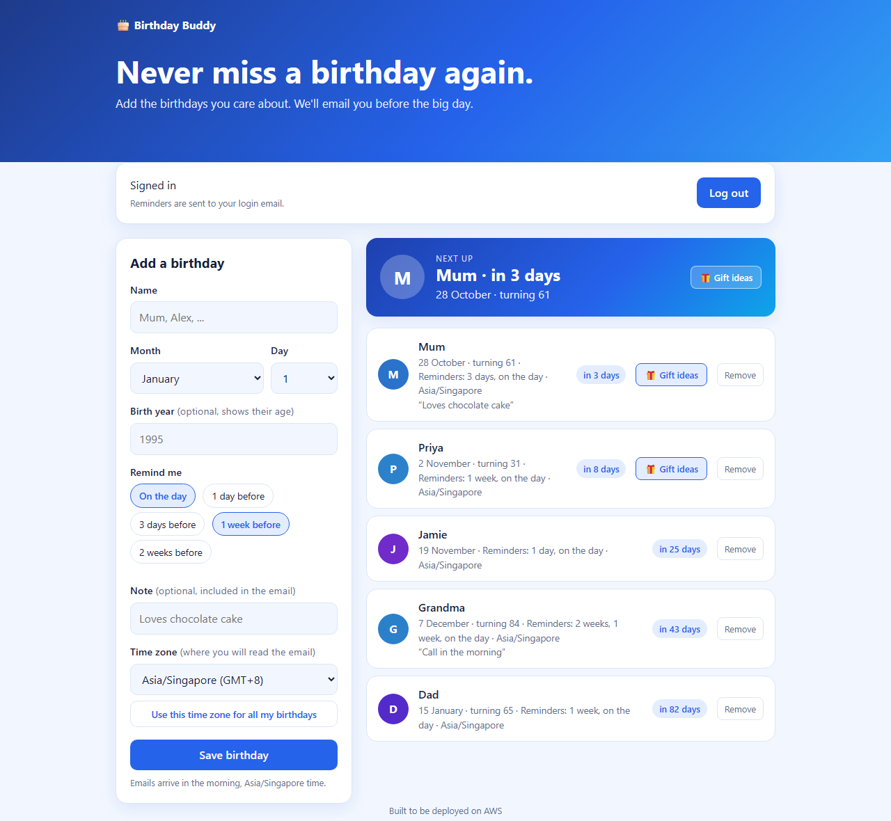
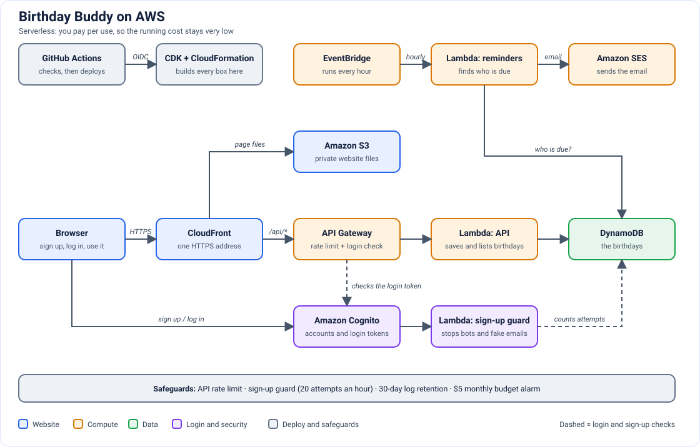

# Birthday Buddy

A web app where you save the birthdays you care about and get an email before each one, every year. Sign up with your email and a password, and your birthdays are saved under your account. (Run locally there is no login: you just enter an email.)


*The log-in and sign-up page.*


*The main page: add a birthday with its time zone, see who is next, and open gift ideas.*

## Tech and architecture


*The website, API, login, reminder job and deploy pipeline, and how they connect.*

- **App:** Node.js backend and a plain HTML, CSS and JavaScript front end.
- **Data:** Amazon DynamoDB (on-demand billing), defined and deployed with AWS CDK (TypeScript) in `cdk/`. It has two indexes: `email-index` (all birthdays for an email) and `monthDay-index` (all birthdays on a given day, used by the hourly reminder job).
- **Storage layer:** the app talks to storage through a small interface, with an in-memory fallback for running locally without AWS and DynamoDB for the real thing.
- **Email:** the app sends through a small mailer interface too. `console` prints the email (the default, nothing leaves your machine) and `ses` sends it with Amazon SES. See [Email: console or SES](#email-console-or-ses).
- **Website:** the page is hosted on Amazon S3 behind CloudFront (a private bucket, HTTPS only). CloudFront also forwards `/api/*` to the API, so the site and the API share one address and no CORS setup is needed.
- **Login:** Amazon Cognito, with the site's own sign-up and log-in page (email and password, verified by an emailed code). API Gateway checks the login token on every API call, and the Lambda takes the email from the verified token.
- **Abuse protection:** an API rate limit, a sign-up guard (refuses throwaway email domains and caps sign-up attempts per hour), 30-day log retention, and an optional $5 monthly spending alarm. See [Abuse protection](#abuse-protection).
- **Why serverless:** the app is small and bursty (one reminder check per hour), so pay-per-use services keep running costs close to zero.

## Status and next steps

- [x] Web app and API logic, running locally
- [x] DynamoDB table with two indexes, deployed with CDK
- [x] App connected to the real table and verified (data survives a restart)
- [x] API Gateway and Lambda for the API
- [x] S3 and CloudFront to host the website
- [x] Hourly reminder job (EventBridge and Lambda), implemented
- [x] Real email sending with SES (in the SES sandbox: verified addresses only)
- [x] Login with Cognito, so each person only sees their own birthdays
- [x] Monitoring and CI/CD
- [x] API rate limit, sign-up guard, 30-day log retention and a $5 spending alarm


## Run locally

```bash
npm install
npm start      # http://localhost:3000
```

Enter any email, then add a birthday for today with "On the day" ticked. To skip the wait for the morning send hour, start with `SEND_FROM_HOUR=0` (`$env:SEND_FROM_HOUR=0; npm start` in PowerShell). Within 30 seconds the "email" is printed in the terminal. Data is in memory, so it disappears when the server stops. Locally the page shows the email box and there is no login. The login page appears only on the deployed site, where the CDK gives the page its Cognito settings.

## Email: console or SES

The mailer is chosen with `MAILER_BACKEND`. The default is `console`, which prints emails instead of sending them, so the app can be run and tested without AWS.

| Mode | Set | What happens |
|---|---|---|
| `console` (default) | nothing | the email is printed in the terminal, or in the Lambda's logs when deployed |
| `ses` | `MAILER_BACKEND=ses` and `SENDER_EMAIL=<address verified in SES>` | the email is sent through Amazon SES |

A new SES account starts in the **sandbox**: it can only send to verified addresses, and the sender and recipient must both be verified in the same region. Any other recipient is refused with `MessageRejected`. The reminder job then leaves that reminder pending and retries on the next run. Sending to anyone requires requesting production access from AWS.

## Run it on your own AWS account

This deploys the app to your own AWS account with your own credentials. The CDK code in `cdk/` creates the DynamoDB table (with both indexes), the Lambda functions, the API, the hourly schedule, the website bucket and CloudFront distribution, and the Cognito user pool for login, so nothing needs to be created by hand.

**Requirements:** an AWS account, [Node.js](https://nodejs.org) 22, and the [AWS CLI](https://aws.amazon.com/cli/) signed in to that account (`aws configure`, or `aws configure sso`). Check with `aws sts get-caller-identity`.

1. **Choose a region.** The stack deploys to the region of your AWS profile, or to `AWS_REGION` if it is set (`$env:AWS_REGION = "ap-southeast-1"` in PowerShell, `export AWS_REGION=ap-southeast-1` in bash). Use the same region in every step below.
2. **Install the dependencies.** From the project folder: `npm install`, then `cd cdk` and `npm install`.
3. **Bootstrap CDK once per account and region.** From `cdk/`: `npx cdk bootstrap`. This creates the resources CDK uses to upload the function code.
4. **Optional, for real emails.** Verify a sender address in SES (same region), then set `SENDER_EMAIL` to it (`$env:SENDER_EMAIL = "you@example.com"` in PowerShell, `export SENDER_EMAIL=...` in bash). While the account is in the SES sandbox, the recipient address must be verified too. Without `SENDER_EMAIL`, the hourly job prints each email to the function's CloudWatch logs instead of sending it.
5. **Optional, a spending alarm.** Set `ALERT_EMAIL` to the address that should receive budget emails (`$env:ALERT_EMAIL = "you@example.com"` in PowerShell, `export ALERT_EMAIL=...` in bash). The stack then creates a $5 monthly budget that emails you at 80% and 100% of actual spend and when the forecast passes $5. Without it, no budget is created.
6. **Deploy.** From `cdk/`: `npx cdk deploy CdkStack`, and approve the permissions prompt. When it finishes it prints:
   - `TableName`: the DynamoDB table
   - `ApiUrl`: the base URL of the API
   - `SiteUrl`: the website address. Open it to sign up and log in
7. **Check the login is enforced.** `curl "<ApiUrl>/api/gifts"` should answer 401 Unauthorized, because every API route needs a login (use `curl.exe` in PowerShell). Then open `SiteUrl`, create an account with a real email, and enter the 6-digit code Cognito emails you.
8. **Use it from your computer (optional).** In one terminal window, set `STORAGE_BACKEND=dynamodb`, `TABLE_NAME=<TableName>` and the same `AWS_REGION`, plus `MAILER_BACKEND=ses` and `SENDER_EMAIL` if you did step 4, then run `npm start`. The first line should say `storage=dynamodb`. The local page has no login, so it saves under whatever email you type.

**Notes.** A local server pointed at a real table runs its own reminder timer alongside the hourly Lambda, so use the in-memory default for everyday work. The local server has no login, so do not point it at a table that holds other people's data. Cognito's default sign-up emails are limited to about 50 a day, which is enough for testing.

**Clean up.** From `cdk/`: `npx cdk destroy CdkStack` deletes the table, the functions, the API, the website bucket and the user pool. Everything is pay-per-use, so running costs are close to zero while it is deployed.

**Your own pipeline (optional).** `.github/workflows/deploy.yml` deploys on every push to `main`. It needs a repository variable `AWS_ROLE_ARN` (the role GitHub may assume, created by `GithubOidcStack`; change the repository name in `cdk/lib/github-oidc-stack.ts` first) and, optionally, the secrets `SENDER_EMAIL` and `ALERT_EMAIL`.

## How it is built

```
frontend/             HTML/CSS/JS, no build step; CDK uploads it to the S3 website bucket
  config.js          API_BASE_URL and the Cognito settings. The repo copy has none (local mode: email box); CDK writes the real one when deploying
backend/lambda/      Lambda handlers: api.js (the API), reminder.js (the hourly job), pre-signup.js (the sign-up guard)
backend/src/
  service.js         all business logic (validate, create, list, delete, the email job)
  storage/           storage interface: memory.js (in-memory fallback) and dynamodb.js
  mailer/            mailer interface: console.js prints emails (the default) and ses.js sends them with SES
  catalog/           gift catalog interface: curated.js is a hand-picked list of gift ideas
  disposable-email.js  throwaway email domains that the sign-up guard refuses
  app.js, server.js  LOCAL ONLY: Express + a timer that stands in for a cloud scheduler
cdk/                 AWS CDK (TypeScript): the DynamoDB table, the Lambdas, the API, the hourly schedule, the website (S3 and CloudFront), the Cognito login, the protections and the GitHub deploy role
.github/workflows/   CI/CD: checks the stack on every push and deploys on main
```

`service.js` knows nothing about HTTP or AWS. It receives a `storage` and a `mailer`, and the Lambda handlers call the same functions.

## Data and API

A **birthday** has: `id`, `email` (where reminders go), `name`, `month`, `day`, `monthDay` (like `"1005"`, added by the app), `year?`, `note`, `remindDaysBefore`, `timezone`, and which yearly reminders were already `sent`. The storage port in [memory.js](backend/src/storage/memory.js) lists every method a real database has to provide.

| Method | Path | Purpose |
|---|---|---|
| POST | `/api/birthdays` | `{ email, name, month, day, year?, remindDaysBefore: [0,1,3,7,14], timezone?, note? }` |
| GET | `/api/birthdays?email=...` | list the birthdays saved under that email (deployed: the email comes from the login token, and the `email` in the request is ignored) |
| DELETE | `/api/birthdays/:id?email=...` | delete one (the email must match) |
| PUT | `/api/timezone` | `{ email, timezone }`: moves every birthday saved under that email to one time zone and returns `{ updated, timezone }` (deployed: the email comes from the login token) |
| GET | `/api/gifts?category=all&q=choc` | gift ideas `[{ id, category, emoji, name, blurb, nearbyLink, onlineLink }]`; `category` is `all`, `cakes`, `flowers`, `treats` or `experiences`; `q` is optional |

**Gift ideas:** when a birthday is within 14 days, it gets a "Gift ideas" button that opens a dropdown and search bar. The ideas are a hand-picked list in `backend/src/catalog/curated.js`, so no outside API or key is needed. Each idea has two links that open in the user's own browser: Google Maps for nearby shops, and a web search. A real shop API would be another file in `backend/src/catalog/`.

When deployed, every API route needs a valid Cognito login token (`Authorization: Bearer <ID token>`), which API Gateway checks before the Lambda runs. The Lambda then uses the email inside the token and ignores any email in the request, so one person cannot read or change another person's list. The local server has no login, so anyone who can reach it can use any email.

The scheduled job is `processDueReminders({ storage, mailer, sendFromHour })`. It runs hourly. Each reminder is recorded so it is emailed once per year, and it is sent once the birthday person's local time reaches `sendFromHour`. The job does not read the whole table: it works out which month-days could be due and asks storage for just those (`listByMonthDay`), so it stays cheap as the number of birthdays grows.

**Time zone:** each birthday saves the time zone its reminders follow. The page starts the dropdown on the browser's current zone and lets you pick another. A button, "Use this time zone for all my birthdays", moves every saved birthday to the chosen zone (`PUT /api/timezone`).

## Abuse protection

- **API rate limit:** each route accepts 10 requests a second, with bursts of 20. Beyond that API Gateway answers 429 without calling Lambda.
- **Sign-up guard:** a Lambda that runs before Cognito creates an account. It refuses throwaway email domains and accepts at most 20 sign-up attempts an hour in total. Its only database permission is `dynamodb:UpdateItem`.
- **Log retention:** Lambda logs are deleted after 30 days.
- **Spending alarm:** an optional $5 monthly budget (see the deploy steps above).
- **Known limits:** the sign-up guard cannot see IP addresses, so a bot can use up the hourly cap. WAF with CAPTCHA would fix that but costs about $6 a month. CloudFront sends no security headers (such as a Content-Security-Policy) yet.

## Build journal

How this project was built, step by step: what I did, what went wrong and how I fixed it, why I chose each AWS service, cost considerations, troubleshooting methods, and what is next. See [BUILD_JOURNAL.md](BUILD_JOURNAL.md).

## Testing and troubleshooting

To check the reminders by hand, start the server with `SEND_FROM_HOUR=0`, then add a birthday for today with "On the day" ticked. The reminder is printed in the terminal within 30 seconds. The local server uses in-memory storage by default, so every run starts empty.
